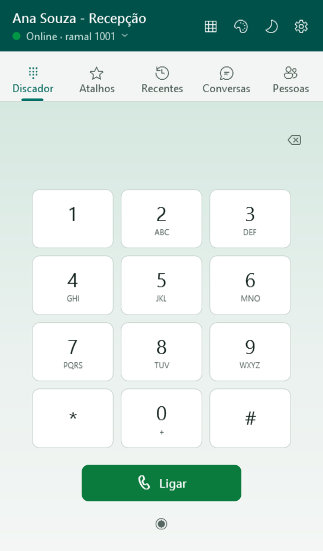
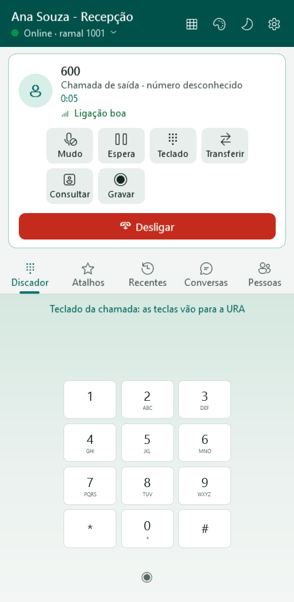
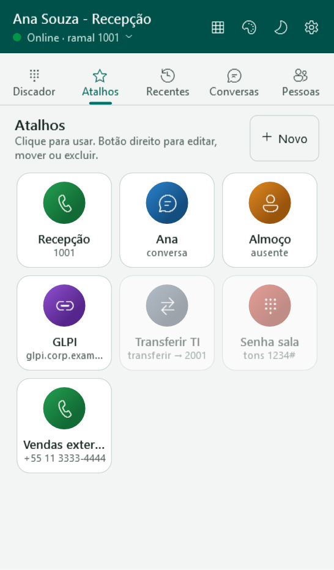
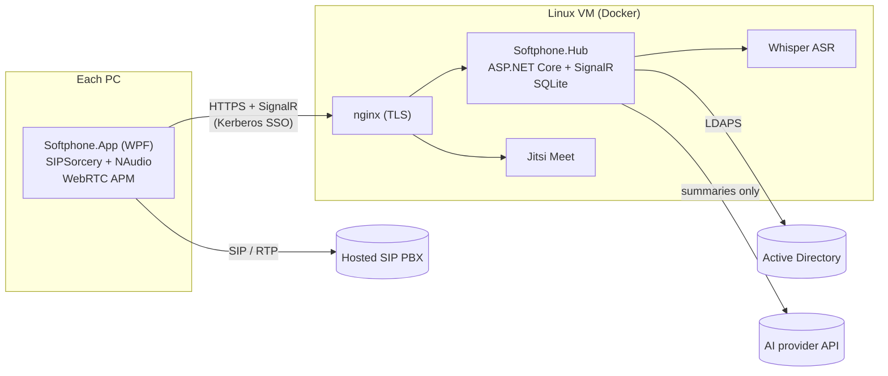

# SIP Softphone + Collaboration Hub

[](https://github.com/gabrielsilva-it/sip-softphone/actions/workflows/tests.yml)

A Windows **SIP softphone** built to replace a basic third-party softphone in a multi-site company, plus a small **self-hosted hub** that adds what a plain SIP client lacks: company directory from Active Directory, presence, chat, video meetings and call recordings with AI summaries.

Built from scratch and used in production with a hosted PBX. This is a generic, sanitised version: no company names, hosts, IPs, extensions or credentials. UI texts are in Portuguese.

---

## Screenshots

Captured with the app's automated test mode against the simulated PBX (fictitious user and extensions).

<p>
  
  
  
</p>

## What it does

**Phone (desktop app)**
- SIP registration, calls, hold, blind/attended transfer (waits for the PBX's final NOTIFY and gives the call back on failure), DTMF, 3-way conference mixed in the app
- Acoustic echo cancellation and noise suppression with the **WebRTC audio processing module** (about 50 dB of echo reduction in the automated tests)
- Live call quality score (**MOS** estimate) on the call card
- Click-to-call: registers `tel:`, `sip:` and `callto:` links for the user
- Call recording to stereo WAV (me / the other side), optional automatic recording
- Shortcuts panel (call, chat, transfer, DTMF, links), themes, ring and key sounds, start with Windows, self-update

**Hub (server)**
- **Directory** synced from Active Directory every 30 minutes; caller identification by extension
- **Presence** (online, away, on a call, do not disturb) and **chat** over SignalR: read receipts, typing, files and screenshots, quotes, edit/delete, mentions, search
- **Single sign-on** with Kerberos (Negotiate), or LDAPS bind as a fallback; account disabled in AD loses access
- **Video meetings** with self-hosted **Jitsi**, using short-lived JWTs issued by the hub (only conversation members can join)
- **Recordings:** local transcription with a **Whisper** container (audio never leaves the network) and summaries/next steps by a configurable AI provider list (Anthropic, OpenAI, Gemini, xAI, DeepSeek or any compatible endpoint), with fallback order and retention policy
- **Web admin panel** (strict CSP, plain JS): AD sync, admin groups, AI providers, announcements, automations, audit log, quality reports
- Brute-force protection on password login, audit trail, encrypted settings (ASP.NET Data Protection)

## Architecture



| Project | Role |
|---|---|
| `src/Softphone.Core` | SIP engine (SIPSorcery), audio (NAudio WinMM), echo/noise processing, conference mixer, quality, hub client |
| `src/Softphone.App` | WPF desktop app |
| `src/Softphone.Contratos` | DTOs shared by app and hub |
| `src/Softphone.Hub` | ASP.NET Core 8 hub: directory, chat, presence, meetings, recordings, AI, web admin panel |
| `src/Softphone.PabxTeste` | Simulated SIP PBX on `127.0.0.1:5090` + automated tests for the engine and the hub |
| `servidor/` | Dockerfile, docker-compose (hub + nginx + whisper), Kerberos and nginx config, install/update scripts, Jitsi installer |
| `deploy/` | Publish, Inno Setup installer, hub package, test runners |

## Optional: SIP account from Active Directory

The hub can hand each user their own SIP extension and password at login, read live from AD attributes, so nobody types SIP credentials. It is **off by default** (`AtributoSenhaSip` empty). Before turning it on, keep in mind that ordinary AD attributes are readable by every authenticated user: mark the attribute as **confidential** (`searchFlags` bit `0x80`) and grant read access only to the hub's service account, or keep secrets in a vault instead. The password is never stored in the hub database or logs.

## Build and test

```powershell
dotnet build Softphone.sln -c Release
dotnet run --project src\Softphone.PabxTeste -c Release   # engine tests against the simulated PBX
.\deploy\Testar-Hub.ps1                                    # starts a test hub (fake AI, fake Jitsi) and runs the hub tests
```

The engine tests cover registration, calls, transfer, DTMF, conference, quality, recording, echo cancellation and noise suppression. The hub tests cover login, directory, chat, presence, meetings, recordings with a fake AI, admin panel APIs, automations and brute-force lockout.

Requirements: .NET 8 SDK, Windows (WPF, WinMM audio). The hub runs on Linux in Docker.

## Tech

C# / .NET 8 · WPF · SIPSorcery · NAudio · WebRTC APM · ASP.NET Core · SignalR · SQLite · Kerberos / LDAPS · Docker · nginx · Jitsi Meet (JWT) · Whisper ASR · Anthropic / OpenAI-compatible APIs · Inno Setup

---

## Resumo em português

Softphone SIP para Windows (WPF/.NET 8) com:
- **Telefonia:** cancelamento de eco e de ruído (WebRTC), nota de qualidade (MOS), conferência a 3, transferência e gravação de ligações.
- **Servidor próprio (Hub):** diretório vindo do AD, presença e chat (SignalR), login único por Kerberos e reuniões por vídeo com Jitsi.
- **Gravações:** transcrição local com Whisper e resumo por IA.
- **Administração:** painel web.

Usado em produção numa empresa com várias unidades; esta é uma versão genérica, sem dados da empresa. A entrega de conta SIP pelo AD vem desligada por padrão, porque guardar senha em atributo do AD exige cuidados de segurança.

## License

[MIT](LICENSE)
